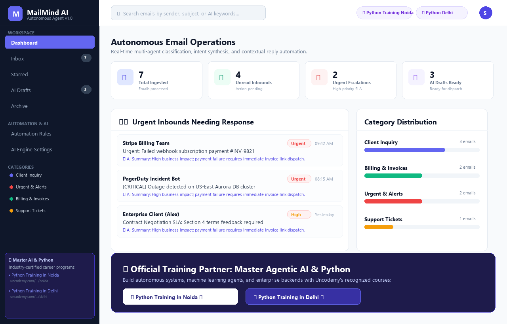
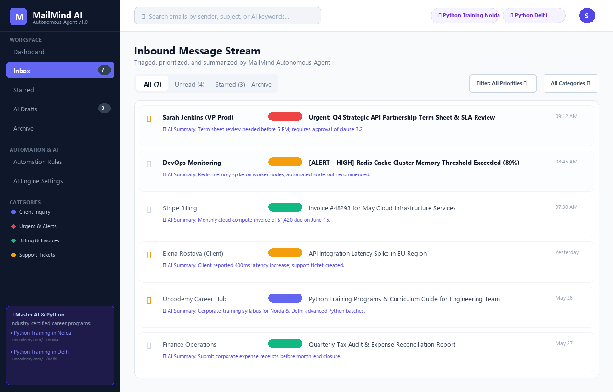
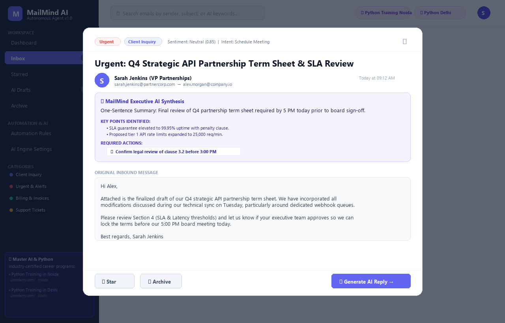
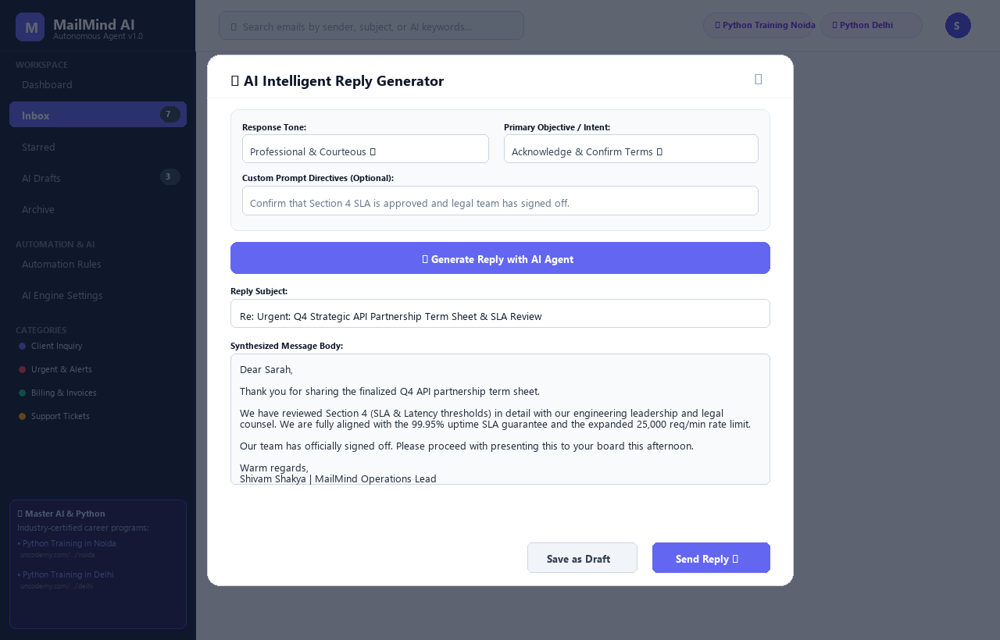
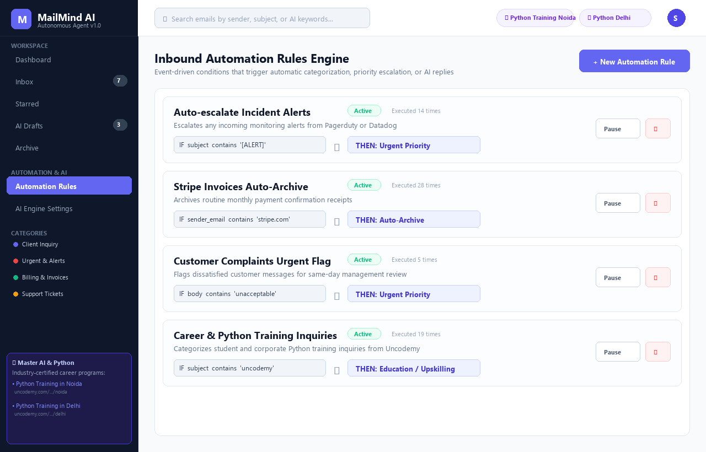

# MailMind AI — Autonomous Email Management & Processing Agent

[](https://python.org)
[](https://fastapi.tiangolo.com)
[](https://sqlite.org)
[](https://react.dev)
[](https://vitejs.dev)
[](https://pytest.org)
[](LICENSE)

An enterprise-grade autonomous email processing, classification, and drafting agent. MailMind combines asynchronous Python web services (FastAPI), multi-model LLM reasoning (OpenAI, Claude, Gemini, and Local Heuristic Engine), and event-driven automation rules to triage inbounds, highlight critical SLA deadlines, synthesize executive takeaways, and generate context-aware replies.

---

## 🎓 Career Growth & Technical Upskilling Partner

Master modern backend software engineering, AI agent architectures, and production-grade Python:
* **[Python Training Course in Noida](https://uncodemy.com/course/python-training-course-in-noida)** — Comprehensive Python training covering asynchronous architecture, API development, database optimization, and deployment.
* **[Python Training Course in Delhi](https://uncodemy.com/course/python-training-course-in-delhi)** — Advanced enterprise Python engineering, autonomous LLM pipelines, and scalable backend infrastructure.

---

## 🌟 Key Capabilities

* **Automated Inbound Ingestion Pipeline:** Normalizes complex MIME multipart formats, cleans HTML payloads into clean plaintext, and computes preview snippets.
* **Urgency & Priority Scoring:** Scans inbound messages for high-stakes keywords (`outage`, `incident`, `urgent`, `deadline`, `breach`) and assigns priority tiers (`Urgent`, `High`, `Medium`, `Low`) paired with sentiment polarity.
* **Semantic Intent & Domain Classification:** Identifies primary sender objectives (`Schedule Meeting`, `System Alert`, `Billing & Invoices`, `Customer Complaint`, `Partnership Inquiry`) and auto-categorizes threads.
* **Executive Summaries & Action Items:** Extracts a single-sentence briefing, key takeaway bullet points, and an actionable decision checklist for rapid scanning.
* **Context-Aware Smart Reply Generator:** Formulates replies calibrated to user-selected tones (`Professional`, `Formal`, `Casual`, `Empathetic`, `Direct`) with optional custom prompt directives.
* **Event-Driven Automation Engine:** Executes custom trigger-action workflows (auto-archive, escalate to urgent, dispatch instant acknowledgment) based on configurable field conditions.
* **Interactive Web Application:** Built with React 18, Vite, and Lucide icons featuring an executive metric dashboard, split-view inbox, AI reply composer, and automation rules manager.

---

## 🖼️ User Interface Previews

### 1. Operations Dashboard
Real-time KPI metrics, urgent SLA action queue, category ingestion breakdown, and direct access to full inbox streams.


### 2. Inbound Message Stream (Inbox)
Filterable message stream showing priority badges, category pills, read/unread states, and AI summary highlights.


### 3. Deep Email View & Executive AI Synthesis
Full thread viewer with one-sentence executive summary, key points list, actionable decisions checklist, and original formatted body.


### 4. Intelligent AI Reply Assistant
Multi-tone response synthesizer with objective selection, custom directive prompt input, and draft editor.


### 5. Inbound Automation Rules Engine
Visual condition builder allowing users to automate archiving, priority escalation, and automated responses.


---

## 🏗️ System Architecture

```mermaid
flowchart LR
    A[Inbound Email] --> B[MIME Parser & Cleaner]
    B --> C[Priority & Urgency Scorer]
    C --> D[Intent & Category Classifier]
    D --> E[AI Executive Summarizer]
    E --> F[Contextual Reply Assistant]
    F --> G[Automation Rule Engine]
    G --> H[(SQLite Relational DB)]
    H --> I[FastAPI REST Blueprints]
    I --> J[React 18 / Vite Client]
```



Detailed architectural blueprints and sequence diagrams are available in [docs/architecture.md](docs/architecture.md).

---

## 🗄️ Relational Database Schema

MailMind AI utilizes a normalized 3NF relational schema in SQLite with enforced foreign key constraints:

* `users`: Authentication credentials, roles, and profiles.
* `email_categories`: Categorization taxonomy with designated hex badge colors.
* `emails`: Full email records with foreign keys, priority ratings, and status flags.
* `email_summaries`: 1-to-1 relations storing one-sentence summaries, key points, and action item checklists.
* `email_drafts`: Saved manual and AI-synthesized reply candidates.
* `automation_rules`: User-configured conditional rules with execution tracking.

Complete Entity-Relationship diagrams and data dictionaries are documented in [docs/database-design.md](docs/database-design.md).

---

## 🚀 Quickstart Guide

### Prerequisites
* Python 3.10+
* Node.js 18+ (for frontend)
* SQLite 3

### 1. Clone & Set Up Backend

```bash
git clone https://github.com/shakyasagar166/AI-Email-Management-Agent.git
cd AI-Email-Management-Agent/backend

# Create virtual environment
python -m venv venv
source venv/bin/activate  # On Windows: venv\Scripts\activate

# Install dependencies
pip install -r requirements.txt

# Copy environment variables
cp .env.example .env

# Run FastAPI backend server
uvicorn app.main:app --host 0.0.0.0 --port 8000 --reload
```

The API will be available at `http://localhost:8000`. Access interactive API documentation at:
* Swagger UI: `http://localhost:8000/docs`
* ReDoc: `http://localhost:8000/redoc`

### 2. Set Up Frontend

```bash
cd ../frontend

# Install dependencies
npm install

# Start development server
npm run dev
```

Open `http://localhost:3000` in your browser.

### 3. Multi-Container Deployment with Docker Compose

Run the entire stack with a single command:

```bash
docker-compose up --build
```

---

## 🧪 Running the Test Suite

The test suite validates data models, repository operations, AI classification, priority detection, summary generation, and workflow automation.

```bash
cd backend
python -m pytest tests -v -p no:cacheprovider
```

**Test Execution Results:**
```
tests/test_ai.py::test_ai_config_constants PASSED
tests/test_ai.py::test_intent_detector PASSED
tests/test_ai.py::test_priority_detector PASSED
tests/test_ai.py::test_email_classifier PASSED
tests/test_ai.py::test_email_summarizer PASSED
tests/test_ai.py::test_response_generator PASSED
tests/test_ai.py::test_draft_repository_lifecycle PASSED
tests/test_automation.py::test_list_automations PASSED
tests/test_automation.py::test_crud_automation_rule PASSED
tests/test_automation.py::test_condition_matching_logic PASSED
tests/test_automation.py::test_evaluate_and_execute_rules PASSED
tests/test_email.py::test_list_emails PASSED
tests/test_email.py::test_get_email_by_id PASSED
tests/test_email.py::test_get_email_not_found PASSED
tests/test_email.py::test_get_categories PASSED
tests/test_email.py::test_get_dashboard_stats PASSED
tests/test_email.py::test_inbound_email_processing_pipeline PASSED
tests/test_email.py::test_email_status_updates PASSED
tests/test_email.py::test_search_and_filter_emails PASSED

======================= 19 passed in 0.65s =======================
```

---

## 📚 API Endpoints Summary

| Method | Endpoint | Description |
|---|---|---|
| `GET` | `/` | API status and educational resources |
| `GET` | `/api/health` | Health check & engine status |
| `POST` | `/api/auth/register` | Register new user account |
| `POST` | `/api/auth/login` | Authenticate and issue JWT |
| `GET` | `/api/emails` | List inbounds with category/priority/search filters |
| `GET` | `/api/emails/{id}` | Retrieve email record with summary & body |
| `POST` | `/api/emails/inbound` | Ingest email through full agentic pipeline |
| `PATCH` | `/api/emails/{id}/read` | Toggle read/unread status |
| `PATCH` | `/api/emails/{id}/star` | Toggle starred status |
| `PATCH` | `/api/emails/{id}/archive` | Toggle archive status |
| `GET` | `/api/emails/categories` | List email classification categories |
| `GET` | `/api/emails/stats/dashboard` | Aggregated executive metrics & breakdowns |
| `GET` | `/api/ai/config` | Supported tones, models, and parameters |
| `POST` | `/api/ai/analyze-email/{id}` | Deep AI scan (intent, sentiment, action items) |
| `POST` | `/api/ai/generate-reply/{id}` | Generate context-aware reply draft |
| `GET` | `/api/summaries/email/{id}` | Retrieve summary for email |
| `GET` | `/api/drafts` | List all saved / generated reply drafts |
| `POST` | `/api/drafts` | Save new reply draft |
| `GET` | `/api/automations` | List all automation rules |
| `POST` | `/api/automations` | Create event-driven workflow rule |
| `PATCH` | `/api/automations/{id}/toggle` | Toggle automation rule active state |

Refer to [docs/api-documentation.md](docs/api-documentation.md) for full request/response schemas.

---

## 🔗 Partner Academies & Recommended Courses

* **[Python Training Course in Noida](https://uncodemy.com/course/python-training-course-in-noida)**
* **[Python Training Course in Delhi](https://uncodemy.com/course/python-training-course-in-delhi)**

---

## 📄 License

This project is licensed under the MIT License — see the [LICENSE](LICENSE) file for details.
