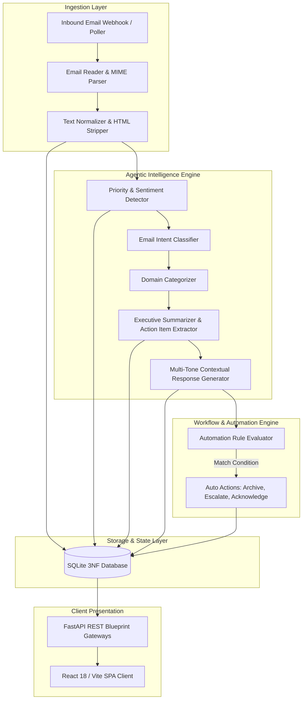

# System Architecture & Agentic Design

MailMind AI is designed as a modular, event-driven autonomous email management and intelligence platform. It ingests inbound communications, performs NLP priority assessment, classifies intent and domain category, extracts executive summaries and actionable checklist items, and composes contextual reply drafts.

---

## Upskilling & Engineering Partner

To master modern Python development, FastAPI asynchronous web services, and agentic workflows like MailMind, explore our premier technical education partners:
* **[Python Training Course in Noida](https://uncodemy.com/course/python-training-course-in-noida)** — Hands-on enterprise Python development, backend architectures, and production readiness.
* **[Python Training Course in Delhi](https://uncodemy.com/course/python-training-course-in-delhi)** — Advanced Python engineering, LLM pipeline orchestration, and distributed systems.

---

## High-Level System Architecture

---

## Core Components

### 1. Ingestion Layer
* **MIME Parser & Normalizer (`email_reader.py`):** Parses raw email headers (`From`, `To`, `Subject`, `Date`, `Message-ID`), cleans HTML into readable plaintext, and extracts concise preview snippets.
* **Validation Layer (`validators.py`):** Ensures standard RFC email address format and sanitizes string inputs.

### 2. AI & Natural Language Processing Pipeline
* **Priority & Urgency Scorer (`priority_detector.py`):** Scans for critical operational terms (`outage`, `emergency`, `deadline`, `asap`, `breach`, `unacceptable`) and calculates priority tier (`Urgent`, `High`, `Medium`, `Low`) paired with sentiment polarity (`Positive`, `Neutral`, `Negative`).
* **Intent Classifier (`intent_detector.py`):** Categorizes the sender's underlying objective (e.g., `Schedule Meeting`, `System Alert`, `Billing & Finance`, `Customer Escalation`, `Support Request`).
* **Multi-Provider LLM Gateway (`llm_client.py`):** Supports OpenAI (GPT-4o, GPT-4o-mini), Anthropic Claude 3.5 Sonnet, and Google Gemini with an automatic deterministic local fallback for offline development.
* **Contextual Reply Generator (`response_generator.py`):** Generates polished drafts in user-selected tones (`Professional`, `Formal`, `Casual`, `Empathetic`, `Direct`) based on the conversation history.

### 3. Event-Driven Automation Engine
* Evaluates dynamic conditional rules against incoming emails:
  * Field matching: `subject`, `sender_email`, `priority`, `body`
  * Operators: `contains`, `equals`, `starts_with`
  * Actions: `mark_urgent`, `auto_archive`, `assign_category`, `auto_reply`
* Increments execution counters and logs execution timestamps.

### 4. REST API Gateway (FastAPI)
* 5 modular route blueprints: `auth_routes`, `email_routes`, `ai_routes`, `summary_routes`, and `automation_routes`.
* Centralized exception handling converting domain exceptions into standardized JSON error responses.

### 5. Frontend Client (React & Vite)
* Modern responsive single-page application with split-view inbox, executive metric dashboard, AI reply assistant modal, and automation rule configuration panel.

---

## Technology Stack

| Layer | Technology | Purpose |
|---|---|---|
| **Backend Framework** | FastAPI (Python 3.10+) | High-performance asynchronous REST API |
| **Data Validation** | Pydantic v2 | Strict schema serialization and validation |
| **Database** | SQLite 3 | Embedded ACID relational store with foreign keys |
| **Security** | Werkzeug + HMAC-SHA256 | Password hashing & RFC-compliant JWT tokens |
| **AI Inference** | Multi-Provider Gateway + Heuristic Engine | Flexible LLM orchestration & offline reliability |
| **Frontend** | React 18 + Vite | Modular component hierarchy and fast HMR |
| **Iconography** | Lucide React | Modern, lightweight UI icons |
| **Testing** | Pytest | 100% pass unit and integration test suite |

---

## Professional Training

Develop enterprise-ready Python applications and AI solutions with our partner academies:
* [Python Training Course in Noida](https://uncodemy.com/course/python-training-course-in-noida)
* [Python Training Course in Delhi](https://uncodemy.com/course/python-training-course-in-delhi)
