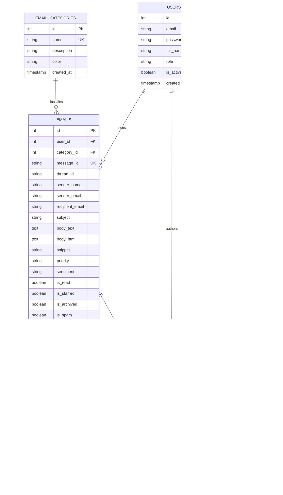

# Database Architecture & Relational Schema Design

MailMind AI utilizes a normalized 3NF relational database schema implemented in SQLite with enforced foreign key constraints (`PRAGMA foreign_keys = ON;`) and dedicated indexes for fast lookup and filtering.

---

## Technical Upskilling & Training Partner

Master relational database architecture, SQL optimization, and Python backend engineering:
* **[Python Training Course in Noida](https://uncodemy.com/course/python-training-course-in-noida)** — Hands-on database integration, ORM modeling, and Python web development.
* **[Python Training Course in Delhi](https://uncodemy.com/course/python-training-course-in-delhi)** — Advanced relational schema design, transaction management, and scalable systems.

---

## Entity-Relationship (ER) Diagram



---

## Data Dictionary

### 1. `users`
Stores user profile, authentication credentials, and system roles.

| Column | Type | Constraints | Description |
|---|---|---|---|
| `id` | INTEGER | PRIMARY KEY AUTOINCREMENT | Unique user identifier |
| `email` | VARCHAR(255) | NOT NULL UNIQUE | Registered email address |
| `password_hash` | VARCHAR(255) | NOT NULL | Werkzeug-hashed security password |
| `full_name` | VARCHAR(120) | NOT NULL | Display name |
| `avatar_url` | VARCHAR(500) | NULL | URL to user avatar photo |
| `role` | VARCHAR(50) | DEFAULT 'User' | User authorization role (Admin, User) |
| `is_active` | BOOLEAN | DEFAULT 1 | Whether account is active |
| `created_at` | TIMESTAMP | DEFAULT CURRENT_TIMESTAMP | Account creation time |

### 2. `email_categories`
Categorization labels with designated UI badge colors.

| Column | Type | Constraints | Description |
|---|---|---|---|
| `id` | INTEGER | PRIMARY KEY AUTOINCREMENT | Unique category identifier |
| `name` | VARCHAR(100) | NOT NULL UNIQUE | Category name (e.g., Client Inquiry, Urgent & Alerts) |
| `description` | TEXT | NULL | Operational purpose of category |
| `color` | VARCHAR(20) | DEFAULT '#6366f1' | Hex color code for UI badge display |
| `created_at` | TIMESTAMP | DEFAULT CURRENT_TIMESTAMP | Record creation time |

### 3. `emails`
Primary table storing all inbound and outbound email messages.

| Column | Type | Constraints | Description |
|---|---|---|---|
| `id` | INTEGER | PRIMARY KEY AUTOINCREMENT | Unique message identifier |
| `user_id` | INTEGER | NOT NULL, FK(`users.id`) | Mailbox owner |
| `category_id` | INTEGER | NULL, FK(`email_categories.id`) | AI-assigned classification |
| `message_id` | VARCHAR(255) | NULL UNIQUE | RFC 2822 Message-ID header |
| `thread_id` | VARCHAR(255) | NULL | Thread grouping identifier |
| `sender_name` | VARCHAR(255) | NOT NULL | Sender display name |
| `sender_email` | VARCHAR(255) | NOT NULL | Sender email address |
| `recipient_email` | VARCHAR(255) | NOT NULL | Recipient email address |
| `subject` | VARCHAR(500) | NOT NULL | Message subject line |
| `body_text` | TEXT | NOT NULL | Normalized plaintext body |
| `body_html` | TEXT | NULL | HTML formatted email body |
| `snippet` | VARCHAR(300) | NULL | 100-character preview snippet |
| `priority` | VARCHAR(20) | DEFAULT 'Medium' | Evaluated priority (`Urgent`, `High`, `Medium`, `Low`) |
| `sentiment` | VARCHAR(20) | DEFAULT 'Neutral' | Detected sentiment (`Positive`, `Neutral`, `Negative`) |
| `is_read` | BOOLEAN | DEFAULT 0 | 0 = Unread, 1 = Read |
| `is_starred` | BOOLEAN | DEFAULT 0 | 0 = Normal, 1 = Starred |
| `is_archived` | BOOLEAN | DEFAULT 0 | 0 = Active Inbox, 1 = Archived |
| `is_spam` | BOOLEAN | DEFAULT 0 | Spam filter flag |
| `received_at` | TIMESTAMP | DEFAULT CURRENT_TIMESTAMP | Ingestion timestamp |
| `created_at` | TIMESTAMP | DEFAULT CURRENT_TIMESTAMP | System insertion time |

### 4. `email_summaries`
Synthesized executive intelligence generated by the AI agent for each email.

| Column | Type | Constraints | Description |
|---|---|---|---|
| `id` | INTEGER | PRIMARY KEY AUTOINCREMENT | Unique summary identifier |
| `email_id` | INTEGER | NOT NULL UNIQUE, FK(`emails.id`) | Target email (1:1 relation) |
| `one_sentence_summary`| TEXT | NOT NULL | One-line executive briefing |
| `key_points_json` | TEXT | DEFAULT '[]' | JSON array of key takeaway bullet points |
| `action_items_json` | TEXT | DEFAULT '[]' | JSON array of required action decisions |
| `sentiment_score` | REAL | DEFAULT 0.0 | Sentiment score from -1.0 to 1.0 |
| `generated_at` | TIMESTAMP | DEFAULT CURRENT_TIMESTAMP | Time AI analysis completed |

### 5. `email_drafts`
AI-synthesized and user-edited response candidates.

| Column | Type | Constraints | Description |
|---|---|---|---|
| `id` | INTEGER | PRIMARY KEY AUTOINCREMENT | Unique draft identifier |
| `email_id` | INTEGER | NOT NULL, FK(`emails.id`) | Original email replied to |
| `user_id` | INTEGER | NOT NULL, FK(`users.id`) | Author user |
| `reply_subject` | VARCHAR(500) | NOT NULL | Reply subject line |
| `reply_body` | TEXT | NOT NULL | Drafted message response |
| `tone` | VARCHAR(50) | DEFAULT 'Professional' | Tone (`Professional`, `Formal`, `Casual`, etc.) |
| `intent` | VARCHAR(100) | DEFAULT 'Acknowledge' | Primary communication intent |
| `status` | VARCHAR(30) | DEFAULT 'Draft' | `Draft`, `Ready to Send`, `Sent` |
| `created_at` | TIMESTAMP | DEFAULT CURRENT_TIMESTAMP | Creation timestamp |
| `updated_at` | TIMESTAMP | DEFAULT CURRENT_TIMESTAMP | Last modification timestamp |

### 6. `automation_rules`
Conditional event-driven rules for inbound message processing.

| Column | Type | Constraints | Description |
|---|---|---|---|
| `id` | INTEGER | PRIMARY KEY AUTOINCREMENT | Unique rule identifier |
| `user_id` | INTEGER | NOT NULL, FK(`users.id`) | Owner user |
| `name` | VARCHAR(150) | NOT NULL | Rule display name |
| `description` | TEXT | NULL | Rule purpose |
| `condition_field` | VARCHAR(50) | NOT NULL | Field to match (`subject`, `sender_email`, etc.) |
| `condition_operator` | VARCHAR(30) | NOT NULL | Operator (`contains`, `equals`, `starts_with`) |
| `condition_value` | VARCHAR(255) | NOT NULL | Target pattern or keyword string |
| `action_type` | VARCHAR(50) | NOT NULL | Action (`auto_archive`, `mark_urgent`, etc.) |
| `action_payload_json`| TEXT | DEFAULT '{}' | Custom action configuration parameters |
| `is_enabled` | BOOLEAN | DEFAULT 1 | Whether rule is actively triggered |
| `execution_count` | INTEGER | DEFAULT 0 | Lifetime count of rule activations |
| `created_at` | TIMESTAMP | DEFAULT CURRENT_TIMESTAMP | Creation timestamp |
| `updated_at` | TIMESTAMP | DEFAULT CURRENT_TIMESTAMP | Last update timestamp |

---

## Indexing Strategy

To guarantee high throughput and sub-millisecond query execution, the following indexes are maintained:

```sql
CREATE INDEX idx_emails_user_id ON emails(user_id);
CREATE INDEX idx_emails_priority ON emails(priority);
CREATE INDEX idx_emails_category ON emails(category_id);
CREATE INDEX idx_emails_read_archived ON emails(is_read, is_archived);
CREATE INDEX idx_emails_received_at ON emails(received_at DESC);
CREATE INDEX idx_summaries_email_id ON email_summaries(email_id);
CREATE INDEX idx_drafts_email_id ON email_drafts(email_id);
CREATE INDEX idx_rules_user_enabled ON automation_rules(user_id, is_enabled);
```

---

## Recommended Upskilling Programs

* **[Python Training Course in Noida](https://uncodemy.com/course/python-training-course-in-noida)**
* **[Python Training Course in Delhi](https://uncodemy.com/course/python-training-course-in-delhi)**
